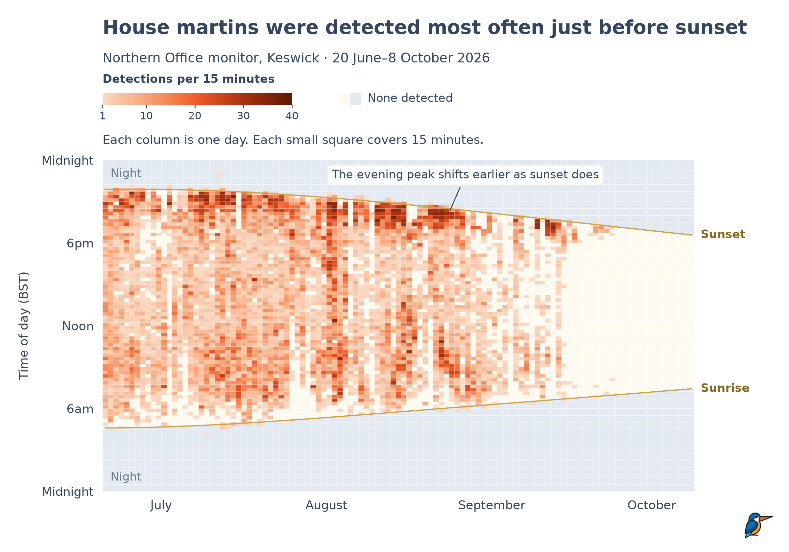
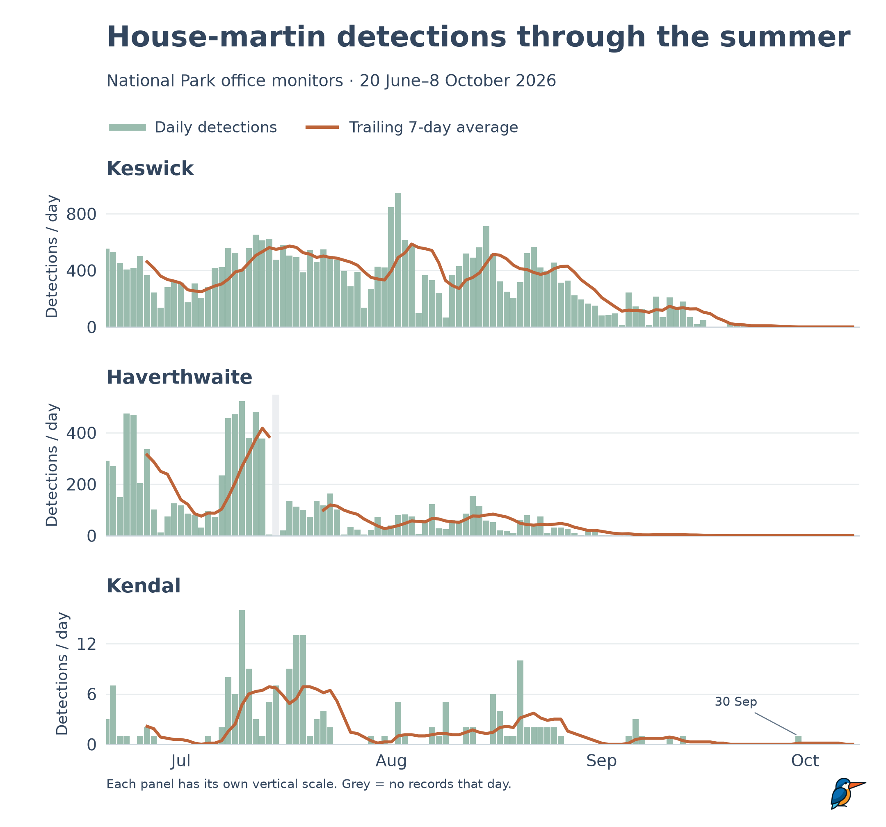

# Day clock

Day clock turns [BirdNET-Go](https://github.com/tphakala/birdnet-go) detections
into seasonal charts for hobbyists, reserves and researchers. It reads either
BirdNET-Go SQLite schema or a CSV export and produces SVG or PNG files.

**A detection is an automatic identification, not an individual bird.** These
charts show detection activity, not bird populations.

The day clock heatmap puts 15-minute detection counts over local daylight and
night. Daily counts show changes through the season with a seven-day average.





Both charts were regenerated with Day clock from Beak Tech's already-published
aggregate counts for 20 June–8 October 2026. Data and original charts:
[What autumn sounds like in the Lakes](https://beaktech.org/blog/listening-to-autumn),
Beak Tech Community Interest Company. No individual detection records are bundled.
The [synthetic example generator](examples/generate.py) lets you try the tool
without any data of your own.

## Install

Requires Python 3.10 or newer. Runtime dependencies are Matplotlib, NumPy and
the standard library. Day clock is not yet published on PyPI: install from this
checkout, rather than running `pip install dayclock` against the package index.

For a command-line installation, run from the checkout:

```sh
pipx install .
```

Or use a virtual environment, which also supports notebooks and Python imports:

```sh
python3 -m venv .venv
source .venv/bin/activate
python -m pip install .
```

These shell examples use macOS/Linux activation. On Windows, activate with
`.venv\Scripts\Activate.ps1` in PowerShell. `python -m dayclock` runs the same
commands as `dayclock`. Every command has `--help`.

## Quick start

Start with a complete BirdNET-Go SQLite backup. If its `-wal` file is present,
keep it alongside the database so recent committed detections are included.
Day clock opens databases read-only and never runs migrations.

List the species and retained detection counts:

```sh
dayclock species --db birdnet.db --tz Europe/London
```

Draw a day clock, using the station's time zone and coordinates:

```sh
dayclock heatmap --db birdnet.db --species "Robin" \
  --tz Europe/London --lat 54.6 --lon -3.13 --out robin.svg
```

**Latitude and longitude are used only for sunrise and sunset.** They do not
filter detections or identify a station. Use your own station's coordinates.

Draw daily counts for one station, or compare several:

```sh
dayclock daily --db birdnet.db --species "Robin" --tz Europe/London --out robin.png

dayclock daily --db first.db --db second.db --label First --label Second \
  --species "Erithacus rubecula" --tz Europe/London --out comparison.svg
```

Choose one complete snapshot per station. Do not combine different backups or
legacy/v2 generations of the same station: IDs and review histories can differ.

| Option | Behaviour |
| --- | --- |
| `--from YYYY-MM-DD`, `--to YYYY-MM-DD` | Inclusive bounds. Each omitted bound uses the first/last retained date across all inputs and all species. |
| `--include-partial` | Keep today when it is the last recorded day. By default that day is omitted in the selected time zone, even with an explicit `--to`. |
| `--tz Europe/London` | Time zone for v2 timestamps and sunlight. Defaults to the system's local zone. |
| `--min-confidence 0.8` | Retain scores at or above this value, on the 0–1 scale. Default: all scores. |
| `--title "My title"`, `--subtitle "My subtitle"` | Override the chart text. Default titles use common names; the default subtitle explains what a detection means. |
| `--vmax 40` | Fix the heatmap colour limit so several heatmaps are comparable. |
| `--label "Station"` | Daily-chart panel label. Supply one per input, in order. Defaults to filenames without extensions; labels must be unique. |

The output extension chooses SVG or PNG. Its parent directory must exist.
Existing chart output is replaced only after a successful render. Heatmaps take
one input; daily charts and species listings can take several.

### English names

Names stored in the database or CSV take priority. When a common name is absent,
Day clock uses the bundled [IOC World Bird List v15.2 English lookup](src/dayclock/resources/IOC-NOTICE.md),
with no network request. For example, `Erithacus rubecula` displays as
`European Robin`; the familiar short search name `Robin` also works.

Scientific names and common names match without regard to case. After exact
matches, Day clock checks whole words at the end of common names among species
present in your data: `Swallow` can select `Barn Swallow`, `Wren` can select
`Eurasian Wren`, and `Robin` can select `European Robin`. It reports the full
name chosen. If several species match, it lists them and asks for a full name.
Recorded names take priority over IOC names; an exact name wins over a short
match. Misspellings suggest close matches. The lookup never adds species
or detections to your records, and an unrecognised scientific name is kept as-is.
The lookup follows IOC's naming and spelling conventions, including `Grey Heron`.

### Dates, partial days and recording gaps

Date defaults use all retained species after review/confidence filtering, so a
selected species can have a valid zero count on a day when others were recorded.
Today is omitted when it is the last recorded day, to avoid a misleading drop
from a day still in progress. Use `--include-partial` to show it. This rule also
applies to the `species` command. A today-only range explains how to opt in.

Historical first and last days are kept. Detection records alone cannot tell
whether those days were fully recorded; use `--from` and `--to` to trim known
partial periods. A first detection at noon is not proof that recording began
at noon. Day clock does not infer recorder uptime.

Legacy databases and CSVs contain local clock strings without an offset; these
are preserved. Choose the station's actual time zone for sunlight and the
meaning of today. V2 stores Unix seconds, which are converted with the requested
zone's historical offsets, including clock changes. A repeated autumn hour
contributes to the same local-clock bins, while detection IDs remain distinct.

## Rules that keep the charts honest

- A detection is an automatic identification, not a bird count.
- False positives are excluded. Detection IDs are de-duplicated within their
  station; a false-positive review on any duplicate wins. Rows without IDs are
  independent detections.
- A day with no retained records is **unknown**, shown hatched on the heatmap or
  grey on daily charts. This includes days containing only false positives or
  records below the chosen confidence threshold. Zero requires other retained
  records on that day.
- The trailing seven-day average needs seven consecutive recorded days. Missing
  days break the line; they are not filled with zeros.
- Empty heatmap cells reveal daylight or night. Positive cells are opaque, so
  the same count has the same colour at any time of day. One column is one day;
  one cell is 15 minutes.
- Sunrise/sunset use location, date and local clock time. The NOAA approximation
  is accurate to minutes, not a precise horizon prediction. Polar dates without
  both sunrise and sunset currently produce a clear error.
- Use the same `--vmax` when comparing heatmaps. Multiple daily panels have
  independent vertical scales, stated on the chart.

Only primary detections count; secondary predictions and model contributions
are not extra detections. All retained labels, including non-species sounds,
can provide evidence of recording coverage.

## CSV input

Use `--csv` instead of `--db`. Each file represents one station. UTF-8 files with
or without a BOM are supported, with these required headers:

```csv
date,time,scientific_name
2025-10-01,07:15:00,Erithacus rubecula
2025-10-01,08:30:00,Turdus merula
```

This tiny example is synthetic. Dates and times are local-clock ISO values,
without offsets. The original article export's `date_local` and `time_local`
headers are also recognised. Optional fields are `common_name`, `confidence`,
`detection_id` (or `id`), `monitor_id`, and `review_status` (or `verified`).
`false_positive` is the excluded review value. Confidence values must be 0–1;
a confidence filter requires a column and scores on every row.

Custom headers are configurable:

```sh
dayclock daily --csv export.csv --species "Robin" \
  --date-column observation_date --time-column observation_time \
  --species-column taxon --out robin.svg
```

Other overrides are `--id-column`, `--monitor-column`, `--review-column`,
`--common-name-column` and `--confidence-column`. They apply to all selected CSVs.
SQLite and CSV inputs are separate command-line alternatives.

## Python and notebooks

```python
from datetime import date, timedelta
import matplotlib.pyplot as plt
from dayclock import aggregate, common_name, daily_counts, read_database

rows = read_database("birdnet.db", tz="Europe/London")
start, end = date(2025, 9, 1), date(2025, 9, 30)
dates = [start + timedelta(days=i) for i in range((end - start).days + 1)]
counts = aggregate(rows, dates, "Erithacus rubecula")
fig = daily_counts({"My station": counts.daily}, dates,
                   title=f"{common_name('Erithacus rubecula')}: daily detections")
fig.savefig("robin.svg")
plt.close(fig)
```

`read_csv` returns the same `Detection` records; its `columns` argument maps
field names to headers, for example `{"date": "observation_date"}`. Readers keep
recorded common names as stored. `common_name(scientific_name, recorded_name)`
returns the recorded name, an IOC fallback, or the scientific name.

`aggregate` returns `daily`, `quarter_hours` and `coverage`, aligned to consecutive
ascending dates. `day_clock(counts.quarter_hours, dates, lat, lon, tz=...)` returns
a heatmap figure. Both plot functions accept titles, subtitles and an optional
logo path, and leave global plotting settings unchanged. The Python API uses
the dates you supply; automatic exclusion of today is a CLI convenience.

## Try the synthetic examples

From an installed source checkout:

```sh
python examples/generate.py
dayclock species --csv .local/examples/synthetic.csv
```

This creates deterministic synthetic detections plus both charts as SVG and PNG
under ignored `.local/examples/`. It reads no backups or real detections. These
synthetic charts are separate from the article charts shown in this README.

To recreate the README images from a local Beak Tech website checkout:

```sh
python examples/regenerate_article.py ../beak-tech/scripts/data/seasonal-2026.json \
  --logo ../beak-tech/public/images/logo.png --out docs/images
```

This reads only the published aggregate counts and optional logo; it does not
copy the source JSON or use detection exports. Grey daily-chart gaps are centred
on the missing day, retaining the correction approved during the original
chart comparison.

## Errors and limits

A missing SQLite or CSV path reports `Database not found: <path>`. An unknown
species offers close matches where available. A range containing no retained
records produces an error; a known species with zero detections during an
otherwise recorded period is valid. Errors exit with status 2; success exits 0.

Incomplete migrations, unsupported schemas and malformed records are rejected.
Input is currently loaded into memory. There is no live HTTP API input, hosted
upload service, BirdNET-Pi reader or multi-species report.

## Development

```sh
python -m pip install -e '.[test]'
python -m pytest
```

Tests use synthetic detections and databases only. The [CI workflow](.github/workflows/tests.yml)
runs the tests and synthetic examples on Python 3.10 and the latest stable
Python 3 (`3.x`, resolved afresh by
[setup-python](https://github.com/actions/setup-python/blob/main/docs/advanced-usage.md#using-the-python-version-input)).
The [plan](PLAN.md) and [review notes](docs/phase-5-review.md) record development
decisions. Version **0.1.0** is prepared locally; see the [changelog](CHANGELOG.md).
Publication to GitHub and PyPI remains for the owner.

## Credits and licences

- **BirdNET**, by the [Cornell Lab of Ornithology and Chemnitz University of
  Technology](https://birdnet.cornell.edu/), provides the identification system.
- **BirdNET-Go**, by [tphakala and contributors](https://github.com/tphakala/birdnet-go),
  provides the station software and database formats.
- **IOC World Bird List v15.2**, edited by Frank Gill, David Donsker and Pamela
  Rasmussen and published through GBIF by the International Ornithologists'
  Union, provides the bundled English species names. The publisher marks the
  [dataset CC BY 4.0](https://www.gbif.org/dataset/c696e5ee-9088-4d11-bdae-ab88daffab78).
  See the [attribution, version, checksum and extraction details](src/dayclock/resources/IOC-NOTICE.md).
- The daylight calculation follows [NOAA's solar equations](https://gml.noaa.gov/grad/solcalc/solareqns.PDF).
- Day clock's original chart design and code were developed by **Beak Tech Community Interest Company**
  for its seasonal bird-detection articles.

Day clock's code, documentation and synthetic examples use the [MIT licence](LICENSE).
The IOC lookup remains separately licensed under [CC BY 4.0](https://creativecommons.org/licenses/by/4.0/);
its attribution and licence notice travel with the installed package. No
endorsement by IOC, IOU, GBIF or the BirdNET projects is implied.
